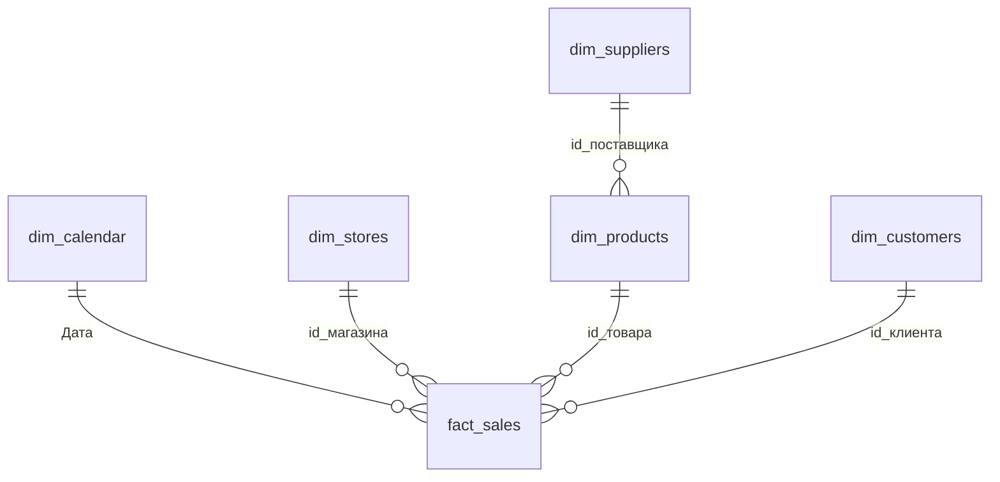

# Анализ продаж сети магазинов «Соседушка» · Power BI

Итоговый проект блока Power BI: интерактивный дашборд и выводы для руководителя продуктовой сети.

**Стек:** Power BI Desktop · Power Query · DAX


## Коротко

- **Выручка 2025 — 11,46 млн ₽, +9,8% к 2024.** Рост в основном за счёт числа чеков (+6,8%), средний чек вырос на 2,8%.
- **Слабее всех растёт Татарстан (+7,8%).** Почти без роста три магазина: Гатчина (+0,9%), на Пресне (+2,5%), Набережные Челны (+3,9%).
- **Карта лояльности не увеличивает чек.** Корзина держателей карт до скидки такая же, как у остальных, а после скидки на 1,6% меньше.
- **Сезонность общей выручки слабая.** Февральский провал объясняется числом дней. Сильная сезонность есть внутри категорий: декабрь у сладостей и алкоголя, лето у напитков и овощей.

## 1. Задача

Руководитель сети задал четыре вопроса. Каждый вопрос был переведён в метрики и визуализации:

| Вопрос заказчика | Метрики и разрезы | Где на дашборде |
|---|---|---|
| Где мы растём, а где проседаем? | Выручка по месяцам, рост к прошлому году (YoY), динамика по регионам, магазинам, категориям | «Обзор»: KPI, линия 2025 vs 2024, регионы; подсказки с YoY |
| Какие магазины лучшие, а какие тянут вниз? | Выручка и средний чек по магазинам, рейтинг | «Детали»: два рейтинга магазинов |
| Помогают ли карты лояльности? | Средний чек с картой и без, разница в % | «Обзор»: блок из трёх карточек |
| Когда у нас сезонные провалы? | Выручка по месяцам, сравнение двух лет | «Обзор»: линия по месяцам |

## 2. Данные

Учебный датасет: продажи сети за 01.01.2024–31.12.2025.

| Таблица | Строк | Содержание |
|---|---|---|
| `fact_sales` | 81 238 | Позиции чеков: дата, магазин, товар, клиент, количество, цена, скидка, сумма (22 790 чеков) |
| `dim_stores` | 20 | Магазины: 4 региона, 3 формата (гипермаркет, супермаркет, у дома), площадь |
| `dim_products` | 101 | Товары: 14 категорий, подкатегории, бренды, поставщик |
| `dim_customers` | 5 000 | Держатели карт лояльности |
| `dim_suppliers` | 20 | Поставщики |
| `dim_calendar` | 731 | Календарь, создан в DAX |

Около 45% чеков сделаны без карты, это использовано для сравнения держателей карт с остальными. Сырая выгрузка `fact_sales_dirty` использовалась только для отработки очистки в Power Query: она дублирует часть `fact_sales`, поэтому в модель не включена.

## 3. Что сделано

**Подготовка (Power Query):** проверены типы столбцов, добавлен столбец «Дата» без времени для связи с календарём.

**Модель:** схема «звезда», поставщики подключены через товары. Календарь помечен как таблица дат.



**Меры DAX** (собраны в отдельной таблице `_Меры`):

| Группа | Меры |
|---|---|
| Базовые | Выручка, Количество чеков, Средний чек, Количество клиентов |
| Доли и лояльность | Доля от общего, Средний чек с картой / без карты, Разница чека |
| Время | Выручка прошлый год, YoY %, Выручка YTD |

**Дашборд, 2 страницы:**
- **«Обзор»:** KPI, выручка по месяцам 2025 vs 2024, блок про карты лояльности, рейтинг регионов.
- **«Детали»:** категории, рейтинги магазинов по выручке и среднему чеку.
- **Дизайн:** один основной цвет и оранжевый акцент на проблемных местах. Магазины с ростом ниже 5% подсвечиваются автоматически (условное форматирование).
- **Интерактив:** сквозные срезы по году, региону и формату, синхронизированные между страницами. Drill-down регион → город → магазин, подсказки с YoY и средним чеком, кнопки навигации.


## 4. Выводы

Цифры — за 2025 год, если не указано иное.

### Где растём, где проседаем
- Сеть выросла на **9,8%**: с 10,43 до 11,46 млн ₽. Каждый месяц 2025 года выше того же месяца 2024. Рост в основном за счёт трафика: чеков +6,8%, средний чек +2,8% (947 → 973 ₽).
- Быстрее всех растут Нижегородская обл. (+12,1%) и Санкт-Петербург и ЛО (+10,7%). **Татарстан отстаёт (+7,8%)**: там два слабых магазина, Набережные Челны (+3,9%) и Казань-Центр (+5,3%).
- Почти не растут **Гатчина (+0,9%), на Пресне (+2,5%), Набережные Челны (+3,9%)**. Лидеры роста — Азино (+21,7%), Парнас (+15,6%), Дзержинск (+14,0%).
- Быстрее всего растут категории «рыба и морепродукты» (+14,9%), «хлеб», «овощи и фрукты» (по +14,8%). Слабее всего — алкоголь (+3,9%) и молочка (+4,4%).

### Лучшие и худшие магазины
- Выручку определяет формат, а не число покупателей. У всех магазинов примерно одинаково чеков (550–680 в год), разница в среднем чеке: гипермаркет ~1 690 ₽, супермаркет ~970 ₽, «у дома» ~485 ₽.
- **Лучший магазин — Парнас:** максимальная выручка (1,16 млн ₽), самый высокий чек (1 715 ₽), рост +15,6%.
- Внутри формата супермаркетов слабее всех **на Пресне** (самый низкий чек 921 ₽, рост +2,5%) и **Набережные Челны** (941 ₽, +3,9%). Среди магазинов «у дома» меньше всего выручки у Бутово, почти нет роста у Гатчины.
- По выручке на 1 м² картина обратная: площадь лучше всего используют магазины «у дома» (Митино — 791 ₽/м² в год), хуже всего гипермаркет Центральный (464 ₽/м²).

### Работают ли карты лояльности
- С картой проходит 55% чеков. При этом **средний чек с картой ниже**: 966 ₽ против 982 ₽ без карты (−1,6%; в 2024 было −4,3%).
- До скидки корзины одинаковые: 982 ₽ против 976 ₽, 4,65 против 4,61 товара. **Вся разница — скидки:** за два года 434 тыс. ₽, около 2% выручки.
- **Вывод:** карта в текущем виде не заставляет покупать больше и работает как скидка. Стоит пересмотреть механику (порог суммы, персональные предложения) и проверить, чаще ли держатели карт возвращаются.

### Когда сезонные провалы
- Общая выручка колеблется умеренно: от 0,88 млн ₽ (февраль) до 1,00 млн ₽ (январь, март) в месяц. **Февральский провал — эффект календаря**: в пересчёте на день февраль на уровне среднего месяца.
- Сильная сезонность есть внутри категорий. **Декабрь:** сладости +34% к среднему месяцу, алкоголь +21%. **Лето:** напитки +23–28%, овощи и фрукты +21%, а сладости проседают на 15–26%.
- Пики разных категорий гасят друг друга, поэтому закупки и промо нужно планировать по категориям, а не по сети в целом.

### Рекомендации
1. Разобрать три отстающих магазина: Гатчина, на Пресне, Набережные Челны.
2. Отдельно посмотреть Татарстан: самый медленный рост среди регионов.
3. Пересмотреть механику карты лояльности.
4. Планировать запасы и промо по сезонности категорий.

## 5. Инструменты

- **Power BI Desktop** — модель, визуализации, интерактив
- **Power Query** — загрузка и подготовка данных
- **DAX** — календарь, меры, time intelligence (`SAMEPERIODLASTYEAR`, `TOTALYTD`)

<details>
<summary>Ключевые формулы DAX</summary>

```DAX
Выручка = SUM ( fact_sales[сумма_строки] )
Количество чеков = DISTINCTCOUNT ( fact_sales[id_чека] )
Средний чек = DIVIDE ( [Выручка], [Количество чеков] )

Средний чек с картой = CALCULATE ( [Средний чек], NOT ISBLANK ( fact_sales[id_клиента] ) )
Средний чек без карты = CALCULATE ( [Средний чек], ISBLANK ( fact_sales[id_клиента] ) )

Выручка прошлый год = CALCULATE ( [Выручка], SAMEPERIODLASTYEAR ( dim_calendar[Date] ) )
YoY % =
VAR _prev = [Выручка прошлый год]
RETURN IF ( HASONEVALUE ( dim_calendar[Год] ) && NOT ISBLANK ( _prev ),
            DIVIDE ( [Выручка] - _prev, _prev ) )
Выручка YTD = TOTALYTD ( [Выручка], dim_calendar[Date] )
```
</details>

## Файлы

- `sosedushka.pbix` — файл отчёта Power BI (открывается в Power BI Desktop)
- `overview.png`, `details.png`, `tooltip.png` — скриншоты дашборда
